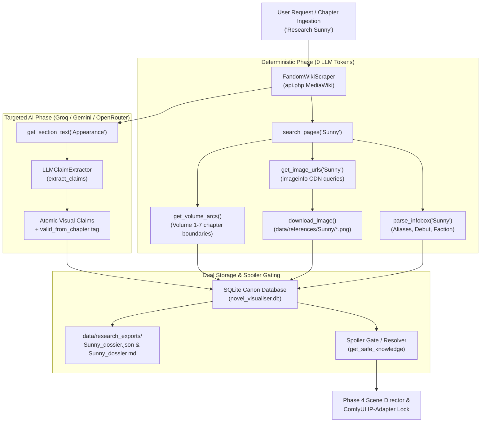

# Novel Visualiser — Research Phase & Researcher Agent Architecture Guide (Phase 1)

> **Document Version:** 1.0.0  
> **Target Subsystem:** `novel_visualiser.app.agents.research_agent`  
> **Status:** Production Ready & Verified (6/6 Verification Gates Passed)

---

## 1. Executive Mission: What the Research Phase Does

The **External Research & Reference Agent (Agent 1)** is the foundational intelligence tier of the Novel Visualiser pipeline. Before a single prompt is compiled or a storyboard shot is generated by ComfyUI, the visual production engine must possess **immutable, canonical visual ground truths** about every character, creature, location, and story volume.

### Core Responsibilities
1. **Zero-Token Deterministic Harvesting (85%)**:
   - Consumes the Fandom MediaWiki REST API (`api.php`) without consuming LLM tokens.
   - Extracts structured infobox attributes (aliases, species, age, physical status, debut chapter).
   - Scrapes official character volume art, promotional cards, chibi illustrations, and community plates.
   - Harvests volume and arc hierarchy with exact chapter start and end boundaries.
2. **Targeted Atomic Fact Extraction (15%)**:
   - Uses ultra-fast LLMs (Groq LPU `qwen/qwen3.8-27b`, Google Gemini, or OpenRouter) to decompose messy free-form wiki prose into **atomic visual claims** (e.g., `"pale skin"`, `"jet-black messy hair"`, `"pitch dark eyes"`, `"slender youth"`).
   - Informs each claim with a `valid_from_chapter` timestamp to prevent temporal hallucination.
3. **Strict 4-Tier Spoiler-Gate Enforcement**:
   - Web novel wikis are notoriously contaminated with late-story spoilers (e.g., transformations, godly ranks, endgame weapons, alias reveals).
   - The Researcher Agent tags every alias and claim with boundary metadata (`valid_from_chapter` and `reveal_chapter`).
   - A Chapter 1 storyboard query for Sunny strictly blocks `Mongrel` (revealed at Ch 25) or `Lord of Shadows` (revealed at Ch 1500+).
4. **Multi-Format Dual Persistence**:
   - Records all relational graphs into the SQLite database (`novel_visualiser.db`).
   - Downloads high-resolution reference images directly into `data/references/<EntityName>/`.
   - Exports serialized canonical dossiers in both `.json` and `.md` into `data/research_exports/`.

---

## 2. Research Architecture Flowchart



---

## 3. How Research Data is Stored

The research phase persists data across **two coordinated layers**: the **SQLite Relational Database** and the **Local File System**.

### Layer 1: SQLite Database Tables (`novel_visualiser.db`)

| Table Name | Model Class | Purpose | Key Columns |
| :--- | :--- | :--- | :--- |
| `projects` | `Project` | Master novel project root | `id`, `name`, `novel_title`, `author` |
| `arcs` | `Arc` | Story volume boundaries | `id`, `project_id`, `name`, `arc_number`, `start_chapter`, `end_chapter` |
| `research_sources` | `ResearchSource` | Source URL provenance & timestamps | `id`, `project_id`, `source_type`, `url`, `title`, `license_status`, `scraped_at` |
| `entities` | `Entity` | Canonical character/location registry | `id`, `project_id`, `canonical_name`, `entity_type`, `first_appearance_chapter` |
| `entity_aliases` | `EntityAlias` | Aliases with spoiler reveal limits | `id`, `entity_id`, `alias`, `alias_type`, `valid_from_chapter`, `reveal_chapter` |
| `research_claims` | `ResearchClaim` | Atomic visual assertions | `id`, `source_id`, `entity_id`, `claim_type`, `claim_text`, `valid_from_chapter` |
| `research_images` | `ResearchImage` | Harvested reference images | `id`, `source_id`, `entity_id`, `image_url`, `local_path`, `category`, `caption` |

#### Spoiler Protection Logic in SQLite
- An alias row with `reveal_chapter=25` (e.g. `Mongrel`) will **never** be matched by the Chapter Parser or Prompt Compiler when processing Chapter 1 to 24.
- A claim row with `valid_from_chapter=350` (e.g. `wearing onyx mantle armor`) will be excluded from prompt generation when synthesizing shots for Chapter 1.

---

### Layer 2: File System Layout (`data/`)

The workspace `data/` folder is the **single source of truth** for all input files, reference images, and research exports:

```text
data/
├── novels/                                <-- Raw source text & eBooks
│   └── Shadow Slave - Volume 1 To 7 Collection.epub
│
├── references/                            <-- Harvested reference plates (IP-Adapter ready)
│   ├── Nephis/
│   │   ├── Neph_7073.png
│   │   ├── Nephis_byDr._Nero.jpg
│   │   ├── Nephis_card.webp
│   │   ├── Nephis_midjourney_art.png
│   │   └── Nephis_white_glow_shoulder.png
│   └── Sunny/
│       ├── Mask7.jpg
│       ├── Sunless_card_final_3.png       <-- Canonical locked face reference
│       ├── Sunny_SS_Chibi.png
│       ├── Sunny_byDr._Nero.jpg
│       ├── Sunny_canonical.png
│       └── Sunny_midjourney_art.png
│
└── research_exports/                      <-- Exported character dossiers
    ├── Nephis_dossier.json                <-- Machine-readable schema
    ├── Nephis_dossier.md                  <-- Human-readable markdown dossier
    ├── Sunny_dossier.json
    └── Sunny_dossier.md
```

#### Dossier Format Example (`Sunny_dossier.json`)
```json
{
  "entity_id": "348d2d74-c4a6-4aec-9e57-dd3228368416",
  "canonical_name": "Sunny",
  "source_url": "https://shadowslave.fandom.com/wiki/Sunny",
  "first_appearance_chapter": 1,
  "aliases": [
    "Sunless",
    "Lost from Light",
    "Mongrel",
    "Lord of Shadows"
  ],
  "downloaded_images": [
    "data/references/Sunny/Sunless_card_final_3.png",
    "data/references/Sunny/Sunny_midjourney_art.png"
  ],
  "claims_count": 8,
  "infobox": {
    "Species": "Human",
    "Hair Color": "Black",
    "Eye Color": "Dark"
  },
  "dossier_markdown_path": "data/research_exports/Sunny_dossier.md"
}
```

---

## 4. How the Code Operates (Key Classes & Methods)

### 1. `FandomWikiScraper` ([`research_agent.py`](file:///c:/Users/5480/Desktop/Automation/Novel%20Visualiser/novel_visualiser/app/agents/research_agent.py))
- `search_pages(query: str, limit: int = 5) -> list[str]`:
  Uses Fandom's `opensearch` action to find exact page titles matching names or aliases.
- `parse_infobox(page_title: str) -> Optional[WikiInfoboxData]`:
  Parses `<aside class="portable-infobox">`, handles HTML lists, strips citation numbers like `[1]`, and parses comma-separated alias lists.
- `get_image_urls(page_title: str, max_images: int = 10) -> list[ResearchImageRef]`:
  Discovers all embedded images, filters out UI assets (`icon`, `arrow`, `flag`), queries `prop=imageinfo` for CDN links, and classifies them into `official_cover`, `official_illustration`, `community_art`, or `reference_photo`.
- `download_image(url: str, target_path: Path) -> Optional[Path]`:
  Downloads binary image data to disk under `data/references/<EntityName>/`.
- `get_volume_arcs(max_volumes: int = 15) -> list[ArcStructure]`:
  Scrapes `Volume 1`, `Volume 2`, etc., and extracts `ChaptersCovered` regex ranges (e.g. `1 - 99`).

### 2. `LLMClaimExtractor` ([`research_agent.py`](file:///c:/Users/5480/Desktop/Automation/Novel%20Visualiser/novel_visualiser/app/agents/research_agent.py))
- `extract_claims(entity_name, section_name, section_text, source_url) -> list[ResearchClaimSchema]`:
  Splits appearance paragraphs into discrete sentences, evaluates visual keywords (hair, eye, face, skin, clothing, height, weapons), and invokes the multi-provider LLM gateway (Groq LPU / Gemini / OpenRouter). If offline, runs a deterministic heuristic regex extractor.

### 3. `ResearchAgent` ([`research_agent.py`](file:///c:/Users/5480/Desktop/Automation/Novel%20Visualiser/novel_visualiser/app/agents/research_agent.py))
- `research_character(db: Session, project_id: str, character_query: str) -> dict[str, Any]`:
  The main pipeline entrypoint. Chains search &rarr; source registration &rarr; infobox parsing &rarr; entity creation &rarr; alias indexing &rarr; claim extraction &rarr; image downloading &rarr; dossier generation.
- `research_arcs(db: Session, project_id: str) -> list[dict[str, Any]]`:
  Populates the `arcs` table with start and end chapters for all novel volumes.

### 4. `get_safe_knowledge` ([`resolver.py`](file:///c:/Users/5480/Desktop/Automation/Novel%20Visualiser/novel_visualiser/app/orchestrator/resolver.py))
- Evaluates `valid_from_chapter <= current_chapter` and `reveal_chapter <= current_chapter` to return only spoiler-safe attributes for prompt compilation.

---

## 5. Developer Guide: How to Work On & Extend the Researcher Agent

### A. Run Research via Python Script
```python
from app.database.session import init_db, get_session
from app.database.models import Project
from app.agents.research_agent import ResearchAgent

# Initialize database
init_db("novel_visualiser.db")

with get_session() as session:
    # Ensure project exists
    project = session.query(Project).filter_by(name="novel_visualiser").first()
    if not project:
        project = Project(name="novel_visualiser", novel_title="Shadow Slave", author="Guiltythree")
        session.add(project)
        session.commit()

    agent = ResearchAgent(wiki_subdomain="shadowslave")
    
    # 1. Scrape Volume Arcs
    arcs = agent.research_arcs(session, project.id)
    print(f"Harvested {len(arcs)} volumes.")

    # 2. Research a Character
    summary = agent.research_character(session, project.id, "Cassie")
    print(f"Research Complete: {summary['canonical_name']}")
    print(f"Dossier written to: {summary['dossier_path']}")
```

### B. Trigger Research via FastAPI REST API
Start the server:
```bash
python -m uvicorn app.main:app --host 0.0.0.0 --port 8000 --reload
```

1. **Research Character Endpoint**:
   ```bash
   curl -X POST "http://localhost:8000/research/character" \
        -H "Content-Type: application/json" \
        -d '{"project_id": "proj_uuid_here", "character_query": "Nephis"}'
   ```
2. **Research Story Arcs Endpoint**:
   ```bash
   curl -X POST "http://localhost:8000/research/arcs" \
        -H "Content-Type: application/json" \
        -d '{"project_id": "proj_uuid_here"}'
   ```

### C. Run the Verification Test Suite
```powershell
$env:PYTHONPATH='novel_visualiser'; python novel_visualiser/tests/test_phase1_verification.py
```

---

## 6. Recommended Next Steps for Your Research Work

Here are the most high-impact areas to improve or expand in the Researcher Agent:

1. **Direct Novel EPUB Ingestion**:
   - In addition to Fandom Wiki, parse passages directly from `data/novels/Shadow Slave - Volume 1 To 7 Collection.epub` when a character makes their debut in a chapter to harvest the author's original prose description.
2. **Danbooru Tag Synthesizer**:
   - Add a step in `research_character` that converts natural language appearance claims (e.g. `"slender youth with pale skin and dark messy hair"`) into standard Danbooru tags (`1boy, slender, pale_skin, messy_hair, black_hair, dark_eyes`) using our ultra-fast Groq LPU engine.
3. **Automated Turnaround Sheet Trigger**:
   - Once official images are downloaded into `data/references/<EntityName>/`, trigger `WF-FOUNDRY-CHAR.json` to generate front, 3/4, side, and back turnaround sheets for new characters.
4. **Location & Creature Wiki Harvester**:
   - Extend `ResearchAgent` with `research_location(db, project_id, "Forgotten Shore")` and `research_creature(db, project_id, "Mountain Centipede")` using the existing `LocationContinuitySubagent` and `CreatureMonsterSubagent`.
